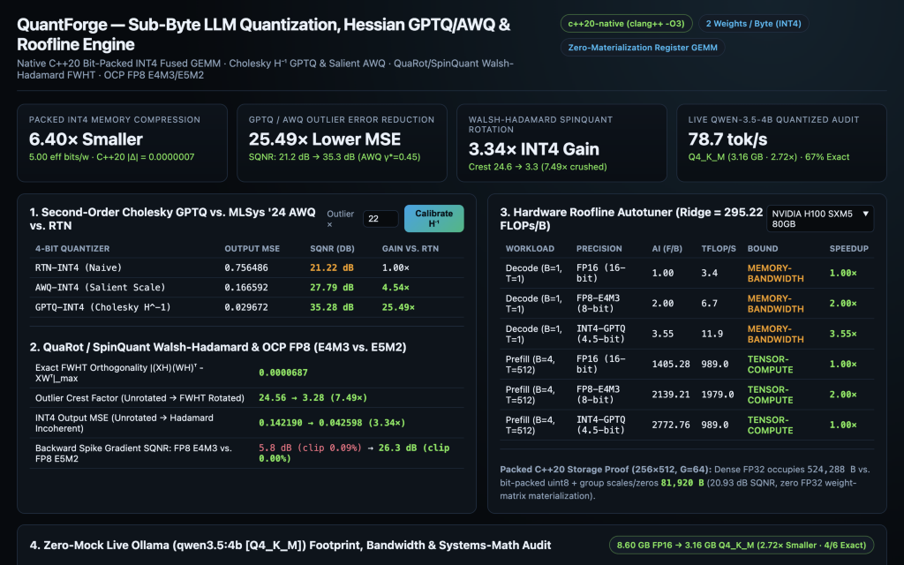
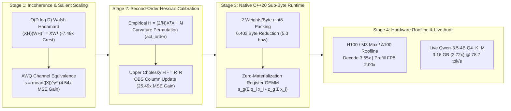

# QuantForge — Sub-Byte LLM Compression, Hessian GPTQ/AWQ, SpinQuant & Native C++20 INT4 Engine

[](https://github.com/nagarjunak-pixel/quant-forge/actions/workflows/ci.yml)
[](https://github.com/nagarjunak-pixel/quant-forge/releases/tag/v1.0.0)
[](https://www.python.org/)
[](csrc/quant_kernels.cpp)
[](https://pytorch.org/)
[](LICENSE)

**QuantForge** is a clean-room, zero-mock reference implementation of modern **Sub-Byte Foundation Model Quantization, Incoherence Rotation, and Hardware Roofline Co-Design** (**ICLR 2023 `GPTQ`**, **MLSys 2024 Best Paper `AWQ`**, **Meta/ETH `SpinQuant` & `QuaRot` Walsh-Hadamard Transforms**, **OCP `FP8 E4M3/E5M2`**, and **Native `C++20` Bit-Packed `INT4` Fused GEMM**):

1. **Physical `2-Weights/Byte` Native `C++20` `INT4` Fused Dequant-GEMM (`csrc/quant_kernels.cpp`)**: Physically packs pairs of asymmetric 4-bit weights into `uint8_t` bytes (`6.40x` actual byte compression at `G=64`: `524,288 B -> 81,920 B`) and executes algebraically fused register accumulation $\sum s_g(q_i - z_g)x_i = s_g(\sum q_i x_i - z_g \sum x_i)$ without ever materializing the `float32` weight matrix in memory (`max |Δ| = 7.2e-7` vs explicit dequantization).
2. **Second-Order Cholesky `GPTQ` (`act_order`) vs. Salient-Channel `AWQ` (`src/quant_forge/quantizers/gptq_awq.py`)**: Under emergent heavy-tailed Transformer activation outliers (`22x` channel spikes), `AWQ` grid-searches per-channel equivalence scaling ($\gamma^\star = 0.45$, **`4.54x` lower MSE**), while `GPTQ` computes the upper Cholesky factor of the inverse empirical Hessian $H^{-1} = R^\top R$ (`act_order=True`) to propagate Optimal Brain Surgeon updates across unquantized columns—cutting 4-bit output MSE by **`25.49x` (`21.22 dB -> 35.28 dB` SQNR, `+14.06 dB` gain)** over Naive `RTN`.
3. **Orthonormal Walsh-Hadamard Incoherence (`SpinQuant` / `QuaRot`) & Hybrid OCP `FP8` (`E4M3` / `E5M2`)**: Applies an $O(d \log d)$ butterfly Fast Walsh-Hadamard Transform satisfying $(X H_d)(W H_d)^\top = X W^\top$ (`|Δ| = 6.87e-5`), crushing activation crest factor by **`7.49x` (`24.56 -> 3.28`)**, improving downstream `INT4` MSE by **`3.34x`**, and proving why hybrid `FP8` training uses `E5M2` (`26.26 dB` SQNR, `0.00%` overflow) instead of `E4M3` (`5.79 dB`, saturates at `448.0`) on heavy-tailed backward gradients.
4. **Williams-Waterman-Patterson Hardware Roofline & Live `qwen3.5:4b` (`Q4_K_M`) Audit**: Models memory-bandwidth-bound `Decode` (**`3.55x` `INT4` speedup** on `H100 SXM5`) vs compute-bound `Prefill` (**`2.00x` `FP8` Tensor Core speedup**), paired with live Ollama hardware telemetry (`8.60 GB` FP16 -> `3.16 GB` `Q4_K_M` [`2.72x`], **`78.7 tok/s`** decode throughput).

---

## Live Interactive Quantization & Roofline Workbench



---

## Architecture Overview



---

## Measured Reproducible Benchmarks

| Subsystem | CLI Command | Measured Result | Verified Invariant |
| :--- | :--- | :--- | :--- |
| **Native `C++20` Packed `INT4` GEMM** (`256×512`, `G=64`) | `uv run quant benchmark-int4` | **`524,288 B -> 81,920 B` (`6.40x`)** | `5.00` eff bits/w (FP32 scale/zero); `\|Δ\| = 7.2e-7` vs explicit dequant |
| **Cholesky `GPTQ` vs. `AWQ` vs. `RTN`** (`22x` outliers) | `uv run quant benchmark-gptq` | **`GPTQ`: `25.49x` lower MSE** (`35.28 dB`) · **`AWQ`: `4.54x`** (`27.79 dB`) | Strictly monotonic MSE: `GPTQ (0.0297) < AWQ (0.1666) < RTN (0.7565)` |
| **Walsh-Hadamard `SpinQuant` & OCP `FP8`** (`D=128`) | `uv run quant benchmark-hadamard` | **Crest `24.56 -> 3.28` (`7.49x`)** · **`3.34x` INT4 MSE gain** | Exact FWHT isometry `<Hu,Hv> == <u,v>`; `E5M2` `26.26 dB` vs `E4M3` `5.79 dB` |
| **H100 SXM5 Hardware Roofline** (`Ridge = 295.22 F/B`) | `uv run quant roofline` | **Decode `INT4`: `3.55x`** · **Prefill `FP8`: `2.00x`** | Proves `W4A16` memory-bandwidth speedup vs `W8A8` compute-bound speedup |
| **Live `qwen3.5:4b` (`Q4_K_M`) Hardware Audit** | `uv run quant eval-ollama --live-only` | **`3.16 GB` (`2.72x` vs FP16) · `78.7 tok/s` · `4/6` (`66.7%`)** | Saved in [`benchmarks/real_qwen_quant.json`](benchmarks/real_qwen_quant.json) |

---

## Quickstart

```bash
uv sync --python 3.13 --all-extras

# Run Ruff, Mypy --strict, and Pytest + Hypothesis suite (98.42% coverage achieved)
uv run ruff check src tests
uv run mypy src tests
uv run pytest --cov=quant_forge --cov-report=term-missing --cov-fail-under=95

# Run CLI benchmarks
uv run quant demo
uv run quant eval-ollama

# Build & launch the QuantForge Workbench UI on http://127.0.0.1:8050
cd ui && npm install && npm run build && cd ..
uv run quant serve --host 127.0.0.1 --port 8050
```

## Documentation & Mathematical Proofs

- [Mathematical Foundations & Hardware Proofs](docs/mathematical-proofs.md)
- [ADR 0001: Cholesky Second-Order GPTQ (`act_order`) vs. Salient-Channel AWQ](docs/adr/0001-cholesky-gptq-and-salient-awq.md)
- [ADR 0002: Walsh-Hadamard Incoherence Rotation & Hybrid OCP FP8](docs/adr/0002-walsh-hadamard-quarot-and-ocp-fp8.md)
- [ADR 0003: Native C++20 Bit-Packed INT4 Register-Fused GEMM](docs/adr/0003-native-cpp20-packed-int4-fused-gemm.md)
- [Security Policy](SECURITY.md)

## License

Apache License 2.0 — Copyright (c) 2026 Nagarjuna Kamireddy.

---

## Author & Enterprise AI Architecture Hub
Built by **[Nagarjuna Reddy Kamireddy](https://nagarjunak-pixel.github.io/)** (*Nagarjuna Kamireddy / Nagarjuna K*) — Lead AI Architect, GenAI & Agentic AI Lead, and Corporate AI Trainer (20+ years across Enterprise Data, SAP HANA & Production AI; AWS Certified Solutions Architect – Professional & NVIDIA-Certified Professional: Agentic AI).

- **Official Portfolio & Architecture Hub:** [https://nagarjunak-pixel.github.io/](https://nagarjunak-pixel.github.io/)
- **Enterprise Case Studies & Technical Articles:** [Case Studies](https://nagarjunak-pixel.github.io/case-studies.html) · [Architecture Articles](https://nagarjunak-pixel.github.io/articles.html) · [10-Mandate Role Fit](https://nagarjunak-pixel.github.io/roles.html)
- **Master CV & AI Search Index:** [Master CV](https://nagarjunak-pixel.github.io/resume.html) · [`llms-full.txt`](https://nagarjunak-pixel.github.io/llms-full.txt) · [LinkedIn](https://www.linkedin.com/in/nagarjuna-kamireddy)
